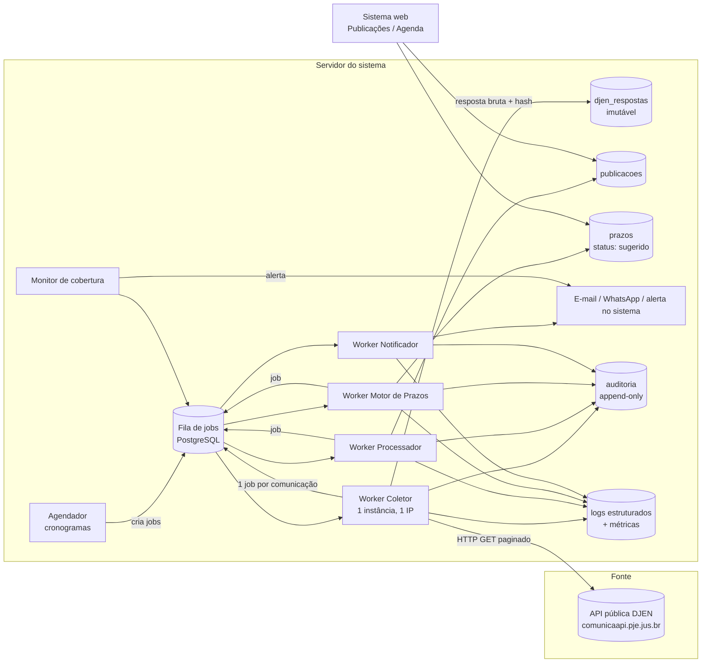
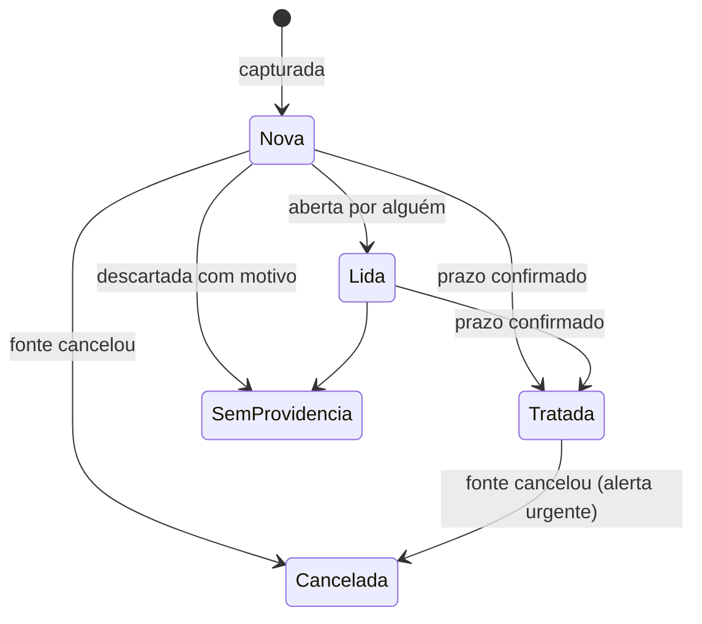
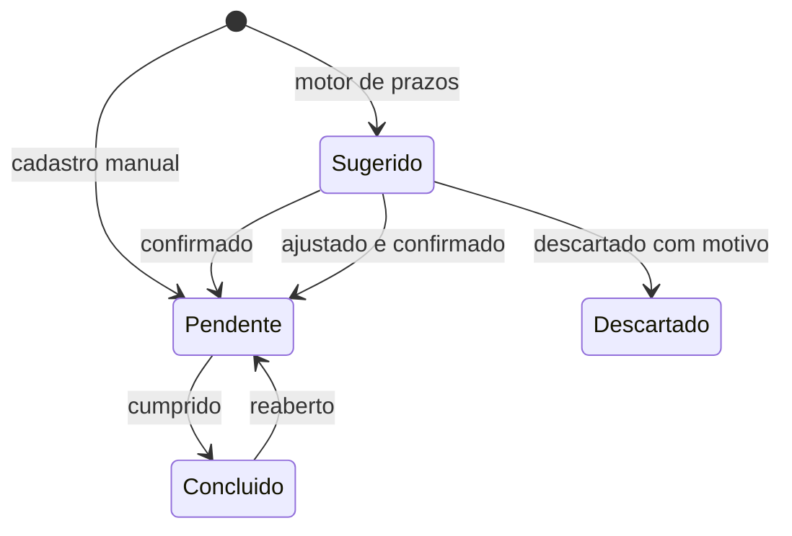

# Arquitetura do Coletor DJEN — Gomes · Sistema Jurídico

Versão: 16/11/2026 · Referências: `especificacao/integracoes.md` (item 2.1), `especificacao/juridico.md` (Publicações e Prazos)
Escopo: uma organização (single-tenant), com estrutura preparada para multiempresa.

## 0. Objetivo e princípios

**Objetivo:** capturar automaticamente, várias vezes ao dia, todas as comunicações publicadas no DJEN para as OABs da equipe, gravá-las com prova de captura, vinculá-las aos processos e transformá-las em **prazos sugeridos** para confirmação humana.

**Princípios de projeto**
1. **Nunca perder uma publicação.** Prefere-se capturar em duplicidade (e deduplicar) a deixar uma janela sem cobertura.
2. **Prova de captura.** Cada resposta do DJEN é guardada como recebida (bruta, imutável, com hash e horário), separada dos dados tratados.
3. **Idempotência.** Todo job pode rodar de novo sem criar registros duplicados.
4. **Falha visível.** Silêncio não é sucesso: uma janela não coberta gera alerta.
5. **Respeito à fonte.** Um único IP, ritmo controlado e obediência aos limites da API. Nada de contornar o limite com vários IPs.
6. **Humano no controle do prazo.** O sistema calcula e sugere; a advogada confirma. A data oficial é sempre a do DJEN e do sistema do tribunal.
7. **Simples de operar.** Um servidor, um banco (PostgreSQL), sem componentes que um escritório não consiga manter.

---

## 1. Visão geral



### Componentes

| Componente | Função | Instâncias |
|---|---|---|
| **Agendador** | Cria, nos horários definidos, um job de varredura por OAB e por janela de datas | 1 |
| **Fila de jobs** | Tabela no PostgreSQL com `FOR UPDATE SKIP LOCKED`, prioridade, tentativas e agendamento futuro. Sem Redis nesta fase | — |
| **Worker Coletor** | Único que fala com o DJEN. Controla o ritmo, pagina, grava a resposta bruta e cria um job por comunicação | **1** (garante IP e ritmo únicos) |
| **Worker Processador** | Normaliza, deduplica, vincula a processo e responsável, grava a publicação | 1 a 2 |
| **Worker Motor de Prazos** | Classifica a comunicação, aplica as regras e cria o prazo **sugerido** | 1 |
| **Worker Notificador** | Envia avisos (sistema, e-mail, WhatsApp) e escala o que não foi confirmado | 1 |
| **Monitor de cobertura** | Verifica se todas as janelas foram cobertas e se o DJEN respondeu; dispara alertas | 1 (job agendado) |

### Pilha recomendada
- **Linguagem:** Python 3.12 (httpx, pydantic para validar o formato, SQLAlchemy ou psycopg).
- **Banco e fila:** PostgreSQL 16. A fila em tabela evita mais um serviço para manter. Pode migrar para Redis/RQ ou Celery se o volume crescer.
- **Agendador:** APScheduler (dentro do serviço) ou cron do sistema chamando um comando que só insere jobs.
- **Execução:** Docker Compose num único servidor: `api`, `scheduler`, `worker-coletor`, `worker-geral`, `postgres`, `backup`.
- **Monitoramento:** logs em JSON, métricas Prometheus (opcional) e um "dead man's switch" externo, como o Healthchecks.io, que alerta se o coletor parar de avisar que está vivo.

---

## 2. Modelo de dados do coletor

Todas as tabelas têm `org_id` com valor fixo nesta fase, o que deixa a migração para multiempresa pronta.

```sql
-- OABs monitoradas (vem da equipe)
CREATE TABLE djen_alvos (
  id            uuid PRIMARY KEY DEFAULT gen_random_uuid(),
  org_id        uuid NOT NULL,
  membro_id     uuid REFERENCES equipe(id),
  numero_oab    text NOT NULL,          -- só dígitos: '123456'
  uf_oab        char(2) NOT NULL,       -- 'MG'
  ativo         boolean NOT NULL DEFAULT true,
  desde         date NOT NULL,          -- início do monitoramento
  UNIQUE (org_id, numero_oab, uf_oab)
);

-- Cada execução de varredura (uma OAB x uma janela)
CREATE TABLE djen_capturas (
  id              uuid PRIMARY KEY DEFAULT gen_random_uuid(),
  org_id          uuid NOT NULL,
  alvo_id         uuid NOT NULL REFERENCES djen_alvos(id),
  janela_inicio   date NOT NULL,
  janela_fim      date NOT NULL,
  motivo          text NOT NULL,        -- 'rotina' | 'reconciliacao' | 'recuperacao' | 'manual'
  status          text NOT NULL,        -- 'pendente' | 'executando' | 'concluida' | 'parcial' | 'falhou'
  iniciada_em     timestamptz, concluida_em timestamptz,
  paginas         int DEFAULT 0,
  total_informado int,                  -- campo count da API
  total_recebido  int DEFAULT 0,
  novas           int DEFAULT 0,
  duplicadas      int DEFAULT 0,
  erro            text
);

-- Resposta bruta, exatamente como veio (prova de captura). Nunca é alterada.
CREATE TABLE djen_respostas (
  id             bigserial PRIMARY KEY,
  org_id         uuid NOT NULL,
  captura_id     uuid NOT NULL REFERENCES djen_capturas(id),
  pagina         int NOT NULL,
  url            text NOT NULL,
  http_status    int NOT NULL,
  headers        jsonb NOT NULL,        -- inclui Date e x-ratelimit-*
  corpo          jsonb,                 -- payload integral
  sha256         char(64) NOT NULL,
  recebida_em    timestamptz NOT NULL DEFAULT now()
);

-- Publicações tratadas (estende a coleção 'publicacoes' do sistema)
ALTER TABLE publicacoes
  ADD COLUMN id_externo      text,       -- identificador da comunicação no DJEN, quando presente
  ADD COLUMN hash_conteudo   char(64),   -- hash normalizado (ver seção 5)
  ADD COLUMN resposta_id     bigint REFERENCES djen_respostas(id),
  ADD COLUMN capturada_em    timestamptz,
  ADD COLUMN cancelada       boolean DEFAULT false,
  ADD COLUMN destinatarios   jsonb,      -- advogados/partes informados pela fonte
  ADD COLUMN link_fonte      text;
CREATE UNIQUE INDEX ux_pub_externo ON publicacoes(org_id, id_externo) WHERE id_externo IS NOT NULL;
CREATE UNIQUE INDEX ux_pub_hash    ON publicacoes(org_id, hash_conteudo);

-- Fila de jobs
CREATE TABLE jobs (
  id            bigserial PRIMARY KEY,
  org_id        uuid NOT NULL,
  tipo          text NOT NULL,
  chave         text NOT NULL,           -- chave de idempotência
  payload       jsonb NOT NULL,
  prioridade    smallint NOT NULL DEFAULT 5,   -- 1 = mais urgente
  status        text NOT NULL DEFAULT 'pronto', -- pronto | executando | concluido | falhou | morto
  tentativas    int NOT NULL DEFAULT 0,
  max_tentativas int NOT NULL DEFAULT 6,
  executar_apos timestamptz NOT NULL DEFAULT now(),
  travado_ate   timestamptz,             -- lease do worker
  ultimo_erro   text,
  criado_em     timestamptz NOT NULL DEFAULT now(),
  concluido_em  timestamptz,
  UNIQUE (org_id, tipo, chave)
);
CREATE INDEX ix_jobs_fila ON jobs(status, prioridade, executar_apos);

-- Auditoria (append-only, encadeada por hash)
CREATE TABLE auditoria (
  id            bigserial PRIMARY KEY,
  org_id        uuid NOT NULL,
  em            timestamptz NOT NULL DEFAULT now(),
  ator          text NOT NULL,            -- 'sistema:coletor' | 'usuario:<id>'
  acao          text NOT NULL,            -- ver seção 9
  entidade      text NOT NULL, entidade_id text NOT NULL,
  antes         jsonb, depois jsonb,
  correlacao_id uuid,                     -- liga captura → publicação → prazo → aviso
  hash_anterior char(64), hash char(64) NOT NULL
);
-- O papel de banco da aplicação recebe só INSERT e SELECT em auditoria e djen_respostas.
```

**Campos novos em `prazos`:** `origem` (`manual` | `automatica`), `status` passa a aceitar `sugerido` e `descartado`, `regra_id`, `confianca` (0 a 1), `fundamentacao` (texto da regra aplicada), `confirmado_por`, `confirmado_em`, `publicacao_id`.

---

## 3. Jobs e fila

### 3.1 Tipos de job

| Tipo | Quem cria | O que faz | Chave de idempotência | Prioridade |
|---|---|---|---|---|
| `djen.varrer` | Agendador, Monitor, usuário | Abre uma `djen_captura` para uma OAB e uma janela, e enfileira a 1ª página | `alvo:janela_inicio:janela_fim:rodada` | 3 |
| `djen.pagina` | `djen.varrer` / a própria página | Busca 1 página (100 itens), grava a resposta bruta, cria `djen.comunicacao` para cada item e enfileira a próxima página | `captura:pagina` | 3 |
| `djen.comunicacao` | `djen.pagina` | Normaliza, deduplica, vincula, grava a publicação | `id_externo` ou `hash_conteudo` | 4 |
| `prazo.sugerir` | `djen.comunicacao` (só quando a publicação é nova) | Classifica, calcula e cria o prazo sugerido | `publicacao_id` | 2 |
| `aviso.enviar` | Motor de prazos, Monitor | Envia notificação por canal | `evento:destinatario:canal` | 2 |
| `aviso.escalar` | Agendado pelo Motor | Se o prazo sugerido não foi confirmado no tempo limite, avisa a administração | `prazo_id:nivel` | 1 |
| `djen.reconciliar` | Agendador (noite) | Revarre janelas fechadas e compara contagens | `data:alvo` | 6 |
| `cobertura.verificar` | Agendador (de hora em hora) | Confere se cada OAB tem captura concluída na rodada esperada | `data:hora` | 1 |
| `manutencao.limpeza` | Agendador (semanal) | Expira logs antigos, compacta jobs concluídos | `semana` | 9 |

### 3.2 Funcionamento da fila
- **Retirada:** `SELECT … FROM jobs WHERE status='pronto' AND executar_apos <= now() ORDER BY prioridade, id FOR UPDATE SKIP LOCKED LIMIT 1`, seguido de `status='executando'` e `travado_ate = now() + 5 min` (lease).
- **Jobs travados:** um job em `executando` com `travado_ate` vencido volta para `pronto`. Isso cobre o caso de o worker ter caído no meio.
- **Conclusão:** `status='concluido'` e `concluido_em`, na **mesma transação** em que os dados do job são gravados (padrão *outbox*: o job seguinte é inserido junto com a publicação, então nunca há publicação sem prazo pendente nem prazo sem publicação).
- **Isolamento do coletor:** apenas o `worker-coletor` retira os tipos `djen.varrer` e `djen.pagina`. Assim existe um só cliente HTTP, um só IP e um só controle de ritmo.

---

## 4. Cronogramas

Fuso: America/Sao_Paulo. "Dia útil" usa o mesmo calendário do sistema (feriados nacionais, locais cadastrados, recesso).

| Quando | Job | Janela consultada (`dataDisponibilizacao`) | Motivo |
|---|---|---|---|
| Dias úteis 06:40 | `djen.varrer` (todas as OABs) | D-3 dias úteis até D | Pegar o que entrou de madrugada e atrasos |
| Dias úteis 09:10, 12:10, 15:10, 18:10 | `djen.varrer` | D-1 dia útil até D | Tribunais enviam ao longo do dia |
| Dias úteis 21:30 | `djen.varrer` | D-1 até D | Última rodada do dia |
| Todos os dias 23:20 | `djen.reconciliar` | D-7 até D | Revarredura completa; compara `count` com o que foi gravado |
| Sábado e domingo 10:15 | `djen.varrer` | D-3 até D | Comunicações disponibilizadas em dia não útil |
| Domingo 03:30 | `djen.reconciliar` | D-30 até D | Reconciliação larga; pega cancelamentos e correções |
| De hora em hora, 07:00–22:00 | `cobertura.verificar` | — | Garante que nenhuma rodada ficou sem execução |
| A cada 5 min | Batimento ("estou vivo") para o monitor externo | — | Detectar o servidor parado |

**Primeira carga:** ao cadastrar uma OAB, o sistema cria `djen.varrer` com `motivo='recuperacao'` para os últimos 60 dias, em blocos de 7 dias, com prioridade baixa.

**Minutos "quebrados"** (06:40, 09:10…) evitam bater na API junto com todo mundo que agenda em hora cheia.

---

## 5. Coleta, ritmo e deduplicação

### 5.1 Requisição
```
GET https://comunicaapi.pje.jus.br/api/v1/comunicacao
    ?numeroOab=123456&ufOab=MG
    &dataDisponibilizacaoInicio=2026-11-12&dataDisponibilizacaoFim=2026-11-16
    &itensPorPagina=100&pagina=1
User-Agent: GomesSistemaJuridico/1.0 (contato: <e-mail técnico do escritório>)
Timeout: conexão 10 s, leitura 30 s
```
- `itensPorPagina` = 100 (a API só aceita 5 ou 100).
- Se `count` > 10.000 (teto da API), a janela é dividida em dias e, se preciso, por `siglaTribunal`. É improvável para um escritório, mas o código trata.

### 5.2 Controle de ritmo (rate limiting)
- *Token bucket* no worker-coletor, começando conservador: **1 requisição a cada 3 s**.
- Lê `x-ratelimit-limit`, `x-ratelimit-remaining` e `x-ratelimit-reset` de cada resposta e ajusta o intervalo para nunca zerar o saldo. Quando `remaining` ≤ 2, espera até o `reset`.
- **HTTP 429:** pausa todo o coletor por 60 s + espera aleatória de 0 a 15 s, e devolve o job à fila sem contar tentativa.
- **Proibido:** paralelizar com vários IPs ou proxies.

### 5.3 Processamento de cada página
1. Grava `djen_respostas` (corpo integral, cabeçalhos, `sha256`, `recebida_em`) **antes** de qualquer tratamento.
2. Valida o formato com pydantic. Campo obrigatório ausente → item vai para **quarentena** (`publicacoes_quarentena`) com alerta, sem travar o restante. Campo novo desconhecido → só registra em log (sinal de mudança na API).
3. Cria um `djen.comunicacao` por item.
4. Se `pagina * 100 < count`, cria `djen.pagina` da próxima página. Senão, fecha a captura com os totais.

### 5.4 Deduplicação (duas camadas)
1. **Identificador da fonte:** se o item trouxer identificador próprio da comunicação, ele vira `id_externo` (índice único).
2. **Hash de conteúdo:** sempre calculado, para cobrir itens sem identificador e mudanças de formato:
```
hash_conteudo = sha256(
  sigla_tribunal | numero_processo_20_digitos | data_disponibilizacao |
  tipo_comunicacao | normalizar(texto)
)
normalizar(texto): remove HTML, junta espaços, minúsculas, remove acentos
```
3. `INSERT … ON CONFLICT DO NOTHING`. Se já existia, soma em `duplicadas` e **não** gera prazo de novo.
4. **A mesma publicação para duas OABs da equipe** (ex.: duas advogadas no mesmo processo) gera **uma** publicação, com as duas OABs registradas em `destinatarios`.
5. **Cancelamento:** se uma comunicação já gravada voltar marcada como cancelada, a publicação recebe `cancelada=true`. Se havia prazo sugerido, ele é descartado; se já estava confirmado, gera **alerta urgente** para o responsável decidir. Nada é apagado.

### 5.5 Vínculo e responsável
1. Número do processo normalizado (20 dígitos) → busca em `processos`.
2. Encontrou: `processo_id` e responsável do processo.
3. Não encontrou: publicação fica com a marca **"processo não cadastrado"**. O responsável é o membro dono da OAB intimada (`djen_alvos.membro_id`), e entra a sugestão "cadastrar processo" (pode puxar dados do DataJud).
4. Órgão e tribunal da fonte alimentam os campos da publicação. A comarca é usada para escolher os feriados locais no cálculo do prazo.

---

## 6. Tratamento de falhas

| Situação | Detecção | Ação | Alerta |
|---|---|---|---|
| Timeout / erro de rede | Exceção do cliente HTTP | Nova tentativa com espera exponencial e aleatória: 30 s, 1 min, 2 min, 4 min, 8 min, 16 min | Após a 3ª falha seguida |
| HTTP 429 | Status 429 | Pausa global de 60 s + aleatório; não conta tentativa | Se ocorrer mais de 10 vezes por hora (ritmo mal ajustado) |
| HTTP 5xx / 502 / 503 | Status | Mesma política de nova tentativa | Após a 3ª falha |
| HTTP 4xx (exceto 429) | Status | Sem nova tentativa (erro nosso ou mudança de API); job vai para `morto` | **Imediato** (técnico) |
| Resposta fora do formato | Validação pydantic | Quarentena do item; página segue | **Imediato** (técnico) |
| DJEN fora do ar por muito tempo | **Circuit breaker:** 5 falhas seguidas abrem o circuito por 15 min; depois uma requisição de teste | Jobs aguardam; rodadas perdidas são refeitas quando o circuito fecha | Imediato para técnico e **administração** ("captura do DJEN suspensa desde HH:MM — conferir manualmente no portal") |
| Contagem não bate na reconciliação | `count` da API ≠ itens gravados na janela | Nova varredura da janela; se persistir, alerta | Técnico |
| Rodada não executada | `cobertura.verificar`: OAB sem captura `concluida` na última rodada esperada | Cria varredura de recuperação | Se às 09:30 de um dia útil alguma OAB não tiver captura concluída do dia: **alerta para a equipe** |
| Servidor parado | Batimento externo não chega por 15 min | — | E-mail/WhatsApp para técnico e administração |
| Job esgotou tentativas | `status='morto'` | Fica visível no painel de integrações, com botão "tentar de novo" | Técnico |
| Erro ao gerar prazo | Exceção no motor | Publicação fica **Nova** (sem prazo), visível na tela de Publicações como hoje | Responsável é avisado de que a publicação precisa de tratamento manual |

**Regra de ouro para a equipe:** se o painel mostrar "captura suspensa" ou "rodada atrasada", a conferência do dia volta a ser **manual no portal do DJEN** até o alerta sumir. O registro da indisponibilidade fica guardado e pode servir de evidência; para pedir devolução de prazo, vale a certidão oficial de indisponibilidade emitida pelo próprio Judiciário.

---

## 7. Fluxo de geração automática de prazos

### 7.1 Visão do fluxo
```mermaid
sequenceDiagram
  participant P as Processador
  participant M as Motor de Prazos
  participant C as Calendário (feriados/recesso)
  participant DB as Banco
  participant N as Notificador
  participant A as Advogada responsável
  P->>DB: publicação nova (status Nova)
  P->>DB: job prazo.sugerir (mesma transação)
  M->>DB: lê publicação + processo
  M->>M: classifica (regras → IA opcional)
  alt sem prazo identificado
    M->>DB: publicação "Lida pelo sistema: sem prazo detectado" (continua para revisão humana)
  else prazo identificado
    M->>C: data de publicação, início e vencimento (dias úteis/corridos, comarca)
    M->>DB: cria prazo status=sugerido, origem=automatica, confianca, fundamentacao
    M->>DB: liga prazo à publicação
    M->>N: aviso.enviar (responsável)
    M->>DB: agenda aviso.escalar (4 h úteis)
  end
  N->>A: "Novo prazo sugerido: Apelação até 07/12 — confirmar"
  A->>DB: Confirma (vira pendente) / ajusta / descarta
  DB->>DB: publicação → Tratada; auditoria registra quem confirmou
```

### 7.2 Etapa 1 — datas oficiais
1. **Disponibilização:** data informada pelo DJEN.
2. **Publicação:** primeiro dia útil seguinte à disponibilização.
3. **Início da contagem:** primeiro dia útil seguinte à publicação (CPC, art. 224, §3º).
4. **Calendário aplicado:** feriados nacionais e forenses, feriados locais **da comarca do órgão** (ex.: Araguari) e recesso de 20/12 a 20/01 (CPC, art. 220), além de suspensões de expediente cadastradas.

### 7.3 Etapa 2 — classificação (o que é o ato e qual o prazo)
Em camadas, da mais confiável para a menos:

| Camada | Como funciona | Confiança |
|---|---|---|
| **A. Prazo expresso no texto** | Expressões como "no prazo de 15 (quinze) dias", "em 5 dias", "prazo de 48 horas". Extrai número e unidade | Alta (0,9) |
| **B. Tabela de regras por tipo de ato e rito** | Ex.: sentença no cível → apelação, 15 dias úteis (CPC, art. 1.003, §5º); decisão → embargos de declaração, 5 dias úteis; sentença trabalhista → recurso ordinário, 8 dias úteis (CLT); sentença no Juizado Especial Cível → recurso inominado, 10 dias úteis; intimação para contrarrazões → mesmo prazo do recurso. A tabela é **editável pelas advogadas** em Configurações | Média (0,7) |
| **C. "Prazo legal" sem número** | Usa a tabela B pelo tipo de ato; se não houver regra, marca para revisão | Baixa (0,5) |
| **D. IA (opcional)** | Modelo de linguagem lê o texto e devolve JSON validado: `{ato, providencia, dias, unidade, fundamento, trecho}`. Nunca é usada sozinha: precisa concordar com A ou B, ou fica com confiança baixa | Limitada a 0,6 se não concordar |
| **Sem prazo** | Certidões, ciência simples, pautas | Publicação vai para revisão humana, sem prazo |

**Ajustes obrigatórios no cálculo**
- **Contagem em dias corridos** quando a regra mandar (ex.: matéria penal, CPP art. 798). Nesse caso a regra precisa estar marcada como "corridos" e o prazo nasce com aviso destacado.
- **Prazo em horas:** convertido conforme a regra configurada e sempre marcado como baixa confiança.
- **Prazos em dobro** (Fazenda Pública, Defensoria) não se aplicam ao escritório e não são somados.
- **Audiência ou perícia com data marcada:** vira compromisso na data indicada, não prazo contado.

### 7.4 Etapa 3 — criação do prazo sugerido
```text
prazo = {
  status: "sugerido", origem: "automatica",
  tipo: "Recurso de Apelação", providencia: "Apelar da sentença",
  publicacao: 2026-11-16, dias: 15, contagem: "uteis",
  vencimento: 2026-12-07, meta_interna: 2026-12-03 (2 dias úteis antes),
  responsavel_id: <do processo ou da OAB>, processo_id, publicacao_id,
  regra_id: "civel.sentenca.apelacao", confianca: 0.7,
  fundamentacao: "Sentença publicada em 16/11/2026; CPC art. 1.003 §5º; 15 dias úteis; feriados de Araguari considerados"
}
```
- Na agenda e nos alertas, o prazo **sugerido** aparece com etiqueta própria ("Sugerido — confirmar") e **já conta para os alertas de urgência**. Um prazo curto não pode esperar confirmação para aparecer.
- **Confirmar** (vira `pendente`), **Ajustar** (muda dias, data ou tipo; a mudança fica registrada) ou **Descartar** (com motivo).
- **Confirmação automática:** **desligada** por padrão. Se o escritório quiser no futuro, só para regras da camada A com confiança ≥ 0,9, e o prazo continua marcado como "gerado automaticamente".

### 7.5 Etapa 4 — avisos e escalonamento

| Momento | Para quem | Canal |
|---|---|---|
| Prazo sugerido criado | Responsável | Alerta no sistema + e-mail (WhatsApp opcional) |
| Vencimento em até 2 dias úteis | Responsável | Alerta no sistema + e-mail, mesmo se ainda sugerido |
| Não confirmado em 4 horas úteis | Administração | E-mail |
| Não confirmado até o fim do dia útil seguinte | Administração + responsável | Alerta urgente |
| Publicação cancelada com prazo confirmado | Responsável + administração | Alerta urgente |

---

## 8. Logs e métricas

### 8.1 Logs estruturados (JSON, uma linha por evento)
```json
{"ts":"2026-11-16T09:10:04-03:00","nivel":"INFO","servico":"worker-coletor",
 "evento":"djen.pagina.ok","correlacao_id":"7f1c…","captura_id":"a2e9…","alvo":"MG123456",
 "pagina":1,"itens":37,"count":37,"http":200,"ms":842,"ratelimit_restante":14}
```
- `correlacao_id` acompanha a cadeia inteira: captura → resposta → publicação → prazo → aviso.
- **Nunca** registrar o texto completo das intimações em log. Ele fica no banco, com acesso controlado (LGPD). O log leva só ids e contagens.
- Retenção: 90 dias para logs operacionais.

### 8.2 Métricas e painel "Integrações" no sistema

| Métrica | Uso |
|---|---|
| Última captura concluída por OAB | Saber se a cobertura está em dia (verde/amarelo/vermelho) |
| Publicações novas por rodada / por dia | Detectar quedas anormais (ex.: 0 publicações num dia em que normalmente há 10) |
| Duplicadas por rodada | Confirma que a revarredura está funcionando |
| Latência e erros HTTP, número de 429 | Ajuste de ritmo |
| Jobs na fila / mortos | Saúde dos workers |
| Prazos sugeridos aguardando confirmação (e há quanto tempo) | Gestão da equipe |
| Tempo entre disponibilização e captura | Indicador de qualidade do serviço |

---

## 9. Auditoria

**O que é registrado** (tabela `auditoria`, append-only):

| Ação | Ator | Conteúdo |
|---|---|---|
| `captura.iniciada` / `captura.concluida` / `captura.falhou` | sistema | Alvo, janela, totais, erro |
| `resposta.recebida` | sistema | Id da resposta bruta, `sha256`, horário |
| `publicacao.criada` / `publicacao.cancelada` | sistema | Id externo, hash, processo vinculado |
| `publicacao.status` | usuário ou sistema | Nova → Lida → Tratada / Sem providência |
| `prazo.sugerido` | sistema | Regra, confiança, datas calculadas |
| `prazo.confirmado` / `prazo.ajustado` / `prazo.descartado` | usuário | Antes e depois, motivo |
| `aviso.enviado` / `aviso.falhou` | sistema | Canal, destinatário (id), evento |
| `config.regra_alterada`, `config.feriado_alterado`, `alvo.criado/desativado` | usuário | Antes e depois |

**Garantias**
- **Encadeamento por hash:** cada linha guarda `hash = sha256(hash_anterior + conteúdo)`. Qualquer alteração posterior quebra a cadeia e é detectável.
- **Permissões de banco:** a aplicação só faz `INSERT` e `SELECT` em `auditoria` e `djen_respostas`. Não há `UPDATE` nem `DELETE`.
- **Âncora diária:** à meia-noite, o hash da última linha do dia é gravado num arquivo de backup externo (e, se desejado, enviado por e-mail à administração). Isso dificulta reescrever o histórico.
- **Prova de captura:** para qualquer publicação é possível mostrar a resposta original do DJEN, o horário de recebimento e o hash, além de quem tratou e quando.
- **Retenção:** respostas brutas e auditoria por no mínimo 5 anos (validar o período com as advogadas, considerando prazos de responsabilidade profissional). Logs operacionais por 90 dias.

---

## 10. Máquinas de estado





---

## 11. Segurança e LGPD
- As publicações contêm nomes de partes e dados de processos. O acesso segue as permissões do sistema (módulo Publicações).
- Banco criptografado em repouso e backups diários criptografados, com teste de restauração mensal.
- A consulta é **só por OAB da equipe**: nada de buscas por terceiros, por CPF ou em massa.
- Credenciais (e-mail, WhatsApp) em variáveis de ambiente ou cofre de segredos, nunca no código.
- O `User-Agent` identifica o sistema e traz um contato técnico, por transparência com a fonte.

---

## 12. Implantação em fases

| Fase | Entrega | Esforço estimado |
|---|---|---|
| **0 — Ponte (já possível)** | Script agendado no computador do escritório que consulta o DJEN por OAB e gera o JSON; a equipe usa **Importar** no protótipo atual, que já deduplica e vincula | 2 a 3 dias |
| **1 — Coletor** | Servidor, fila, agendador, coleta com ritmo, resposta bruta, deduplicação, publicações | 1,5 a 2 semanas |
| **2 — Confiabilidade** | Monitor de cobertura, circuit breaker, reconciliação, painel de integrações, batimento externo | 1 semana |
| **3 — Prazos automáticos** | Calendário no servidor, camadas A e B, prazo sugerido, confirmação na agenda, avisos e escalonamento | 1,5 a 2 semanas |
| **4 — Auditoria completa e IA opcional** | Encadeamento por hash, âncora diária, camada D (IA) com validação | 1 semana |

**Critérios de aceite antes de desligar a conferência manual**
1. 30 dias corridos com cobertura de 100% das rodadas.
2. Comparação diária, nesse período, entre o que o coletor capturou e a consulta manual no portal do DJEN, sem nenhuma divergência.
3. Pelo menos 95% dos prazos sugeridos confirmados sem ajuste de data. Os ajustes servem para corrigir a tabela de regras.
4. Teste de falha simulada (DJEN fora do ar, servidor parado) com alertas chegando à equipe em até 15 minutos.
