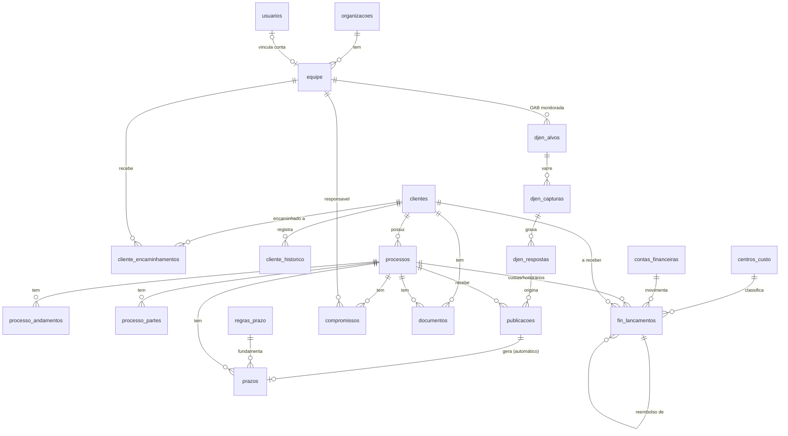

# Modelo físico PostgreSQL — Gomes · Sistema Jurídico

Versão: 16/11/2026 · DDL completo: `especificacao/modelo-fisico.sql` (PostgreSQL 16)
Validado: o script foi aplicado num PostgreSQL 16 limpo, sem erros, e passou nos testes funcionais listados na seção 4.
Revalidado em 21/11/2026: o DDL completo (incluindo `modelos_documento`, `compromissos` e as colunas de 19/11/2026) foi aplicado num PostgreSQL 16 limpo, sem erros. Para `compromissos` foram testados as restrições de horário e o registro na auditoria.

## 1. Tabelas (29) por área

| Área | Tabelas |
|---|---|
| Organização e acesso | `organizacoes`, `usuarios`, `equipe`, `permissoes_papel` |
| Configuração e calendário | `configuracoes`, `feriados` |
| Clientes | `clientes`, `cliente_encaminhamentos`, `cliente_historico` |
| Processos | `processos`, `processo_partes`, `processo_andamentos` |
| Coletor DJEN | `djen_alvos`, `djen_capturas`, `djen_respostas` |
| Publicações | `publicacoes`, `publicacoes_quarentena` |
| Prazos e agenda | `regras_prazo`, `prazos`, `compromissos` |
| Documentos | `documentos`, `modelos_documento` |
| Financeiro | `centros_custo`, `contas_financeiras`, `fin_lancamentos` |
| Infraestrutura | `jobs`, `avisos`, `integracoes_log`, `auditoria` |

Visões: `vw_saldo_contas`, `vw_fluxo_mensal`, `vw_cobertura_djen`, `vw_prazos_abertos`.
Funções: `org_atual()`, `membro_atual()`, `so_digitos()`, `normalizar()`, `cnj_valido()`, `proximo_job()`, `liberar_jobs_travados()`, `verificar_auditoria()`.

## 2. Relacionamentos principais

## 3. Decisões de modelagem

| Decisão | Motivo |
|---|---|
| `org_id` em todas as tabelas de negócio, com padrão `org_atual()` e Row-Level Security já ativa | Hoje existe uma organização só. Para multiempresa basta a aplicação definir `app.org_id` na sessão, sem mudar tabelas |
| Domínios em `text` + `CHECK` (não `ENUM`) | Incluir um valor novo é só alterar a constraint, sem recriar tipo |
| Dinheiro em `bigint` (centavos) | Sem erro de arredondamento; igual ao protótipo |
| `numero_digitos` e `numero_valido` gerados no processo | Busca e unicidade pelo número sem máscara; o dígito verificador CNJ fica registrado sem bloquear o cadastro (a especificação permite salvar com aviso) |
| Unicidade de publicação por `hash_conteudo` e por `id_externo` | Deduplicação em duas camadas, conforme o coletor |
| Índice único `ux_prazo_auto_pub` | No máximo uma sugestão automática de prazo por publicação |
| `prazos.status` aceita `sugerido` e `descartado` (descarte exige motivo) | Fluxo de confirmação humana dos prazos automáticos |
| `fin_lancamentos`: pago ⇔ data e valor da baixa preenchidos; reembolsável só em contas a pagar; parcela completa ou vazia | Regras do financeiro garantidas no banco, não só na tela |
| `auditoria` e `djen_respostas` somente inserção (gatilho + `REVOKE`) | Prova de captura e trilha de auditoria imutáveis |
| Auditoria encadeada por hash, com bloqueio por organização | Qualquer alteração posterior é detectada por `verificar_auditoria()` |
| Gatilhos `tg_rastreio` e `tg_auditar` | Preenchem quem/quando e registram antes/depois em todas as tabelas de negócio. A aplicação informa o membro com `SET app.membro_id` |
| Fila de jobs em tabela com `FOR UPDATE SKIP LOCKED` | Sem Redis nesta fase; idempotência pela chave única `(org_id, tipo, chave)` |
| `modelos_documento` guarda só o texto com campos `{{...}}`; o documento gerado vai para `documentos` como PDF | O preenchimento é feito na aplicação (lista de campos em `App.CAMPOS_MODELO`). O PDF guardado é a versão assinada/entregue, mesmo que o modelo mude depois |
| Clientes, processos e lançamentos não são apagados em cascata | Excluir um cliente ou processo deixa os registros ligados sem vínculo (`ON DELETE SET NULL`), conforme a especificação |

## 4. Testes executados

| Teste | Resultado |
|---|---|
| Aplicar o DDL completo num PostgreSQL 16 limpo | OK, sem erros |
| `cnj_valido` com número real (0111503-98.2011.8.13.0035) e com dígito alterado | Verdadeiro / falso |
| Rastreio automático (`criado_por` pelo `app.membro_id`) | OK |
| Publicação duplicada (mesmo hash) | Ignorada (`ON CONFLICT`) |
| Segunda sugestão automática para a mesma publicação | Bloqueada (índice único) |
| Prazo descartado sem motivo | Bloqueado (`CHECK`) |
| Saldo da conta (saldo inicial + baixa) | R$ 10.000,00 + R$ 3.500,00 = R$ 13.500,00 |
| `proximo_job` retira e trava o job | OK (status `executando`, 1 tentativa) |
| Cadeia de auditoria | Íntegra (`verificar_auditoria()` = nulo) |
| `UPDATE` em `auditoria` | Bloqueado |

## 5. Ajustes em relação ao protótipo

| Protótipo (`js/schema.js`) | Banco definitivo |
|---|---|
| `processos.andamentos` (lista dentro do processo) | Tabela `processo_andamentos` (origem manual/DataJud/fornecedor) |
| `clientes.encaminhadoPara` e `clientes.historico` (listas) | Tabelas `cliente_encaminhamentos` e `cliente_historico` |
| `config/geral.feriadosLocais` | Tabela `feriados` (com comarca e tribunal) |
| `config/geral.contas` + `saldosIniciais` | Tabela `contas_financeiras`; `fin_lancamentos.conta` vira `conta_id` |
| `config/permissoes` | Tabela `permissoes_papel` (módulo `modelos` incluído) |
| Coleção `modelos` | Tabela `modelos_documento` (`tipo` com `CHECK`, nome único por organização) |
| `equipe.genero` (M/F/vazio) | `equipe.genero char(1)`, nulo permitido (modelos usam "Dr(a)." e "advogado(a)") |
| `clientes.nacionalidade`, `estadoCivil`, `profissao`, `rg`, `representanteNome`, `representanteCpf`, `representanteCargo` | Colunas `nacionalidade`, `estado_civil`, `profissao`, `rg`, `representante_nome`, `representante_cpf`, `representante_cargo` (qualificação PF/PJ nos modelos) |
| `clientes.historico[].tipo = 'documento'` ("Documento gerado: …") | `cliente_historico.tipo = 'documento'` (valor já previsto no `CHECK`) |
| `config/geral.escritorioNome` / `escritorioCidade` | `configuracoes.escritorio_nome` / `escritorio_cidade` |
| Honorários informados ao gerar documento | Não são gravados: valem só para o documento gerado (o PDF guardado em `documentos` é o registro) |
| `fin_lancamentos.competencia` (AAAA-MM) | `date` do 1º dia do mês |
| `fin_lancamentos.parcela {n,total,grupo}` | Colunas `parcela_n`, `parcela_total`, `parcela_grupo` |
| `documentos.assetId` | `storage_chave` + `sha256` (armazenamento próprio) |
| `equipe.contaId` / `contaPendente` | `usuario_id` / `vinculo_pendente_usuario_id` |
| Coleção `notif_estado` (por pessoa: `vistas`, `lidas`, `dispensadas` por chave) | Linhas em `avisos` com `canal = 'sistema'`: a chave vira `evento` + `entidade_id` (ex.: `prazo.vencido` + id do prazo), `destinatario_id` = membro, `criado_em` = vista, `lido_em`, `dispensado_em` (coluna nova). As regras de geração de `js/m-notificacoes.js` passam para o Worker Notificador. |
| Campos camelCase | Colunas snake_case (mapeamento direto na migração) |
